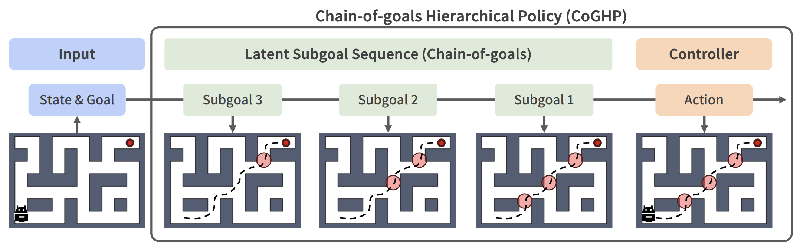

<div align="center">

# Chain-of-Goals Hierarchical Policy for Long-Horizon Offline Goal-Conditioned RL

## [Paper](https://arxiv.org/abs/2602.03389) / [Project Page](https://wlsdn9350.github.io/projects/coghp/)



</div>

# Overview
**CoGHP** is a unified hierarchical policy for long-horizon offline goal-conditioned reinforcement learning. It generates a **chain-of-goals**, a sequence of latent subgoals followed by the primitive action, using an autoregressive policy. This formulation enables the agent to decompose long-horizon tasks into intermediate steps while maintaining awareness of the final goal.

# Installation
CoGHP implementations require Python 3.9+ and additional dependencies, including `jax >= 0.4.26`.
To install these dependencies, run:

```shell
cd impls
pip install -r requirements.txt
```

# Reproducing the main results
An agent can be trained by executing `main.py` script.

Commends:
```shell
# pointmaze-medium-navigate-v0
python main.py --env_name=pointmaze-medium-navigate-v0 --eval_episodes=50 --agent=agents/coghp.py
# pointmaze-large-navigate-v0
python main.py --env_name=pointmaze-large-navigate-v0 --eval_episodes=50 --agent=agents/coghp.py --agent.num_subgoals=1 --agent.subgoal_steps=50
# pointmaze-giant-navigate-v0
python main.py --env_name=pointmaze-giant-navigate-v0 --eval_episodes=50 --agent=agents/coghp.py --agent.num_subgoals=3 --agent.subgoal_steps=50 --agent.feature_dim=32 --agent.lr=1e-5

# antmaze-medium-navigate-v0
python main.py --env_name=antmaze-medium-navigate-v0 --eval_episodes=50 --agent=agents/coghp.py
# antmaze-large-navigate-v0    
python main.py --env_name=antmaze-large-navigate-v0 --eval_episodes=50 --agent=agents/coghp.py --agent.num_subgoals=1 --agent.subgoal_steps=50 --agent.feature_dim=128
# antmaze-giant-navigate-v0
python main.py --env_name=antmaze-giant-navigate-v0 --eval_episodes=50 --agent=agents/coghp.py --agent.num_subgoals=2 --agent.subgoal_steps=50 --agent.feature_dim=128

# cube-single-noisy-v0
python main.py --env_name=cube-single-noisy-v0 --eval_episodes=50 --agent=agents/coghp.py --agent.subgoal_steps=10 --agent.num_subgoals=1 --agent.gc_enc=None --agent.feature_dim=32
# cube-double-noisy-v0
python main.py --env_name=cube-double-noisy-v0 --eval_episodes=50 --agent=agents/coghp.py --agent.subgoal_steps=10 --agent.num_subgoals=1 --agent.gc_enc=None --agent.feature_dim=128 --agent.lr=3e-5
# cube-triple-noisy-v0
python main.py --env_name=cube-triple-noisy-v0 --eval_episodes=50 --agent=agents/coghp.py --agent.subgoal_steps=10 --agent.num_subgoals=1 --agent.gc_enc=None --agent.feature_dim=256 --agent.lr=3e-5

# scene-play-v0
python main.py --env_name=scene-play-v0 --eval_episodes=50 --agent=agents/coghp.py --agent.subgoal_steps=10 --agent.num_subgoals=1 --agent.gc_enc=None --agent.feature_dim=256

# visual-antmaze-medium-navigate-v0
python main.py --env_name=visual-antmaze-medium-navigate-v0 --train_steps=500000 --eval_episodes=50 --agent=agents/coghp.py --agent.encoder=impala_small --agent.high_alpha=3.0 --agent.low_actor_rep_grad=True --agent.low_alpha=3.0
# visual-cube-single-noisy-v0
python main.py --env_name=visual-cube-single-noisy-v0 --train_steps=500000 --eval_episodes=50 --eval_on_cpu=0 --agent=agents/coghp.py --agent.encoder=impala_small --agent.high_alpha=3.0 --agent.low_actor_rep_grad=True --agent.low_alpha=3.0 --agent.p_aug=0.5 --agent.feature_dim=32 --agent.subgoal_steps=10
```

# FM-CoGHP extension

FM-CoGHP jointly generates the complete far-to-near latent subgoal chain with conditional flow matching. It can draw
multiple chains and select one with the existing CoGHP value function or a local contrastive bridge critic.
FM-CoGHP training outputs are stored under `${DATA_ROOT}/exp/FM_CoGHP/`.

```shell
# AntMaze Large (one subgoal).
bash scripts/train_fm_coghp.sh large

# AntMaze Giant (two subgoals, joint-chain setting).
bash scripts/train_fm_coghp.sh giant

# Select among four candidates with the local CRL critic.
FLOW_SELECTOR=local_crl FLOW_CANDIDATES=4 bash scripts/train_fm_coghp.sh giant
```

Supported selectors are `none`, `coghp_value`, and `local_crl`. The same checkpoint can be evaluated with different
selectors by restoring it with a different `--agent.flow_selector` override. Offline candidate diagnostics are
available through `scripts/diagnose_fm_coghp_checkpoint.py`.

Run the synthetic interface and gradient-boundary tests with:

```shell
JAX_PLATFORMS=cpu python -m unittest impls/test_fm_coghp.py -v
```

# Navigation CoGHP / HRM Action study

The completed October 9–10 navigation campaigns are associated with one
consolidated baseline, tagged **`exp/navigation-20261012-baseline`** on branch
**`research/navigation`**. [Experiment registry](experiments/registry.json)
records both campaign locations, original snapshot hashes, protocol and software
versions. [Per-run results](experiments/navigation_results_20261012.csv) contains
54 runs (nine environments, two methods, three seeds), the three exact evaluation
scores, their mean, and source CSV/config hashes. Success rates are fractions in
`[0, 1]`; multiply by 100 for percentages.

This is a retrospective consolidated version: the original runs used uncommitted
working-tree snapshots based on `4f5242f`. Both snapshots and this baseline have
identical training/model/environment source (140 files); the two original full
snapshots differ in launch/management/test/documentation files, recorded in the
registry. Their original metadata is preserved. The fixed tag associates both
campaigns with this baseline without claiming they ran from a pre-existing Git
commit. Resolve its commit with `git rev-parse exp/navigation-20261012-baseline^{commit}`.
Future development continues on the branch; the experiment tag remains fixed.

`experiments/navigation_hrm_action.json` declares six navigation environments,
original CoGHP seeds 0/1/2, and vanilla-planner HRM H2L2 **truncated** seed 0
(24 runs). Scientific settings live in this file, not shell environment variables.
The protocol is 1M updates, evaluation every 100k, all tasks, 50 episodes/task,
temperature 0. The primary score averages steps **800000, 900000, 1000000**;
those three checkpoints are retained. HRM has one seed and no across-seed SD.

```bash
cd /home/eai/Research/CoGHP
PYTHON=/home/eai/Tools/miniforge3/envs/brain_nav/bin/python
RUN_ROOT=/data/qijunrong/06-RL/offline-rl/exp/CoGHPNavigation_20261009
"$PYTHON" scripts/run_study.py --run-root "$RUN_ROOT" --gpus 0,1 --dry-run
# Run manually after reviewing the plan and reserving both GPUs:
"$PYTHON" scripts/run_study.py --run-root "$RUN_ROOT" --gpus 0,1 --execute
"$PYTHON" scripts/run_study.py --run-root "$RUN_ROOT" --summarize
```

The launcher uses one sequential worker per GPU, checks GPU occupancy/JAX,
hashes all datasets, and copies the actual tracked/untracked source into
`<run-root>/source/`. The snapshot records the observed Git commit, dirty state,
and SHA256 hashes, so uncommitted source is not misrepresented as clean HEAD.
Training imports only the copied project. Keep the snapshot unchanged; the same
campaign always reuses it. This is a content snapshot, not a detached Git worktree.
W&B defaults to offline (`--wandb-mode online` is optional); local CSVs are primary.

Artifacts live at `runs/<method>/<environment>/seed_NNN/attempt_NNN/`:
`run.json` records command/GPU/status, `stdout.log` captures output, and
`artifacts/` contains `flags.json`, `reproducibility.json`, `train.csv`, `eval.csv`,
checkpoint metadata and `params_<step>.pkl`. Summaries print to the terminal and
reject missing/duplicate metric steps instead of substituting a tail average.
Validated completed attempts are skipped; partial/failed attempts are preserved
and require an explicit `--attempt N` with `--methods`/`--environments` filters.
Retries are fresh training runs, not optimizer-state resume. A failure stops new
dispatch while in-flight jobs finish; Ctrl-C/SIGTERM stops child process groups.
For later launches use the copied `source/scripts/run_study.py` if development
code has changed. The old grid scripts remain legacy entry points and do not
define this study.

## Humanoid and three-seed completion

`experiments/navigation_hrm_action_multiseed_extension.json` adds exactly 30 runs:
HumanoidMaze medium/large/giant with both methods at seeds 0/1/2 (18), and HRM
PointMaze/AntMaze medium/large/giant seeds 1/2 (12). The previous 24 runs are reused,
giving 54 distinct identities. Humanoid uses `subgoal_steps=100`, `feature_dim=128`,
`discount=0.995`, and K=1/1/2. Other numerical settings and evaluation remain fixed.

Results use `/data/qijunrong/06-RL/offline-rl/exp/Navigation/<date>_<description>/`.
Frozen runtime code uses `/home/eai/Research/Navigation/<date>_<description>/`;
continue development in `/home/eai/Research/CoGHP`, never in the frozen directory.
`--source-root` separates code from artifacts, and `--prepare` hashes datasets and
copies source without accessing GPUs or starting training. `campaign.json` records
the source location; `source/` in the result directory is a compatibility symlink.
On subsequent invocations the stored study and source are used automatically.

```bash
PYTHON=/home/eai/Tools/miniforge3/envs/brain_nav/bin/python
NAME=20261010_coghp_vs_hrm_h2l2_humanoid_and_seed_completion
RUN_ROOT=/data/qijunrong/06-RL/offline-rl/exp/Navigation/$NAME
SOURCE_ROOT=/home/eai/Research/Navigation/$NAME

# One-time preparation from the development tree (no training):
"$PYTHON" scripts/run_study.py \
  --study experiments/navigation_hrm_action_multiseed_extension.json \
  --run-root "$RUN_ROOT" --source-root "$SOURCE_ROOT" --prepare

# Review and launch from the prepared code:
"$PYTHON" "$SOURCE_ROOT/scripts/run_study.py" --run-root "$RUN_ROOT" --gpus 0,1 --dry-run
"$PYTHON" "$SOURCE_ROOT/scripts/run_study.py" --run-root "$RUN_ROOT" --gpus 0,1 --execute

# Joint 54-run summary; no files are rewritten:
"$PYTHON" "$SOURCE_ROOT/scripts/run_study.py" --run-root "$RUN_ROOT" --summarize \
  --summarize-with /data/qijunrong/06-RL/offline-rl/exp/Navigation/20261009_coghp_vs_hrm_h2l2_point_ant_pilot
```

Joint summaries check training/model/environment source hashes, shared dataset
hashes, agent settings and evaluation protocol. Duplicate method/environment/seed
identities are rejected. Missing runs remain incomplete, not a reduced-seed mean.
Different seeds within a method can be declared per environment; methods can also
restrict their environment scope. These declarations prevent baseline duplication.

# Acknowledgments
This code is based on [OGBench](https://github.com/seohongpark/ogbench) repository.

# Citation
```shell
@article{choi2026chain,
  title={Chain-of-Goals Hierarchical Policy for Long-Horizon Offline Goal-Conditioned RL},
  author={Choi, Jinwoo and Lee, Sang-Hyun and Seo, Seung-Woo},
  journal={arXiv preprint arXiv:2602.03389},
  year={2026}
}
```
